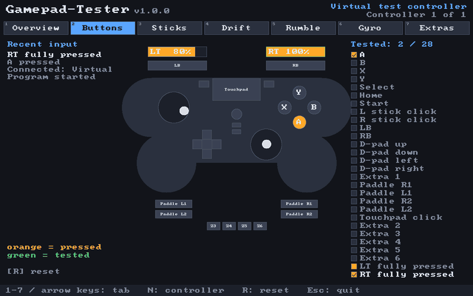

# gamepad-tester

[](https://github.com/soliTR/gamepad-tester/actions/workflows/ci.yml)
[](https://github.com/soliTR/gamepad-tester/releases/latest)
[](LICENSE)
[](https://scorecard.dev/viewer/?uri=github.com/soliTR/gamepad-tester)

Graphical Linux program for testing gamepads: every button, both sticks, stick drift, rumble, gyro, touchpad and LEDs. Written in C with SDL3.

Made for the PS5 DualSense, 8BitDo controllers and the Nintendo Switch 2 Pro Controller (USB only), and works with most other controllers SDL supports.



*Recorded with the built-in virtual controller (`GAMEPAD_TESTER_VIRTUAL=1`).*

## Features

| Tab | Content |
| --- | --- |
| 1 Overview | Name, type, IDs, connection, battery, available features, event log |
| 2 Buttons | Controller graphic with live display and a checklist that ticks off every pressed button |
| 3 Sticks | Both sticks live with trail and raw values, analog triggers |
| 4 Drift | Rest test (5 s, traffic-light rating), magnified center view, circle test with roundness error |
| 5 Rumble | Left/right motor individually, strength slider, alternating test, ramp, trigger rumble if available |
| 6 Gyro | Live values from gyro and accelerometer, 3D view, history graph, gyro rest test with bias measurement |
| 7 Extras | Touchpad, LED color, player LED, battery |

## Contents

- [Download a release](#download-a-release) (no building needed)
- [Build from source](#build-from-source)
- [udev rules for rumble, gyro and LED](#udev-rules-for-rumble-gyro-and-led)
- [Usage](#usage)
- [Troubleshooting](#troubleshooting)
- [Security](#security)
- [Development](#development)
- [Contributing](#contributing)

## Download a release

The [releases page](https://github.com/soliTR/gamepad-tester/releases/latest) has ready-to-run archives for `x86_64` (most PCs) and `aarch64` (ARM). They contain a single program file with SDL built in and run on any distribution with glibc 2.35 or newer (Ubuntu 22.04, Debian 12, Fedora 36 or newer).

### 1. Verify the download

Every release comes with a `SHA256SUMS` file and a signed build provenance attestation. Download the archive and `SHA256SUMS` into the same folder, then:

```bash
sha256sum --check --ignore-missing SHA256SUMS
```

This shows that the file is complete and unchanged. To also confirm that it was built by this repository's [release workflow](.github/workflows/release.yml) on GitHub's servers from the tagged source code, and not uploaded by someone else, check the attestation with the [GitHub CLI](https://cli.github.com):

```bash
gh attestation verify gamepad-tester-1.0.0-linux-x86_64.tar.gz --repo soliTR/gamepad-tester
```

It must report that the verification succeeded. The same signed provenance is attached to every release as `gamepad-tester-<version>.intoto.jsonl`; with it, the check also works without fetching anything from GitHub's API:

```bash
gh attestation verify gamepad-tester-1.0.0-linux-x86_64.tar.gz --repo soliTR/gamepad-tester --bundle gamepad-tester-1.0.0.intoto.jsonl
```

See [Security](#security) for what this does and does not prove.

### 2. Run it

```bash
tar xzf gamepad-tester-1.0.0-linux-x86_64.tar.gz
./gamepad-tester-1.0.0-linux-x86_64/gamepad-tester
```

### 3. Install it (optional)

For your own user, without root:

```bash
cd gamepad-tester-1.0.0-linux-x86_64
install -Dm755 gamepad-tester ~/.local/bin/gamepad-tester
install -Dm644 gamepad-tester.desktop ~/.local/share/applications/gamepad-tester.desktop
```

It then starts with `gamepad-tester` or from the application menu. `~/.local/bin` must be in your `PATH`; most distributions do this already. To uninstall, delete the two files again.

## Build from source

### Quick way

The script installs the right packages for your distribution and prints the build command:

```bash
git clone https://github.com/soliTR/gamepad-tester.git
cd gamepad-tester
scripts/install-deps.sh
cmake -B build            # add -DGAMEPAD_TESTER_BUNDLED_SDL=ON if the script says so
cmake --build build
./build/gamepad-tester
```

### Packages by distribution

The program needs SDL3 3.4 or newer. Where the distribution ships an older SDL3 (or none), CMake downloads SDL3 itself and links it into the program: configure with `-DGAMEPAD_TESTER_BUNDLED_SDL=ON`. The download is pinned to a fixed version and verified by its SHA-256 checksum.

| Distribution | SDL3 | Packages |
| --- | --- | --- |
| Arch Linux, CachyOS, Manjaro | system | `sudo pacman -S --needed base-devel cmake sdl3 libusb` |
| Fedora (current releases) | system | `sudo dnf install gcc cmake SDL3-devel libusb1-devel` |
| openSUSE Tumbleweed | system | `sudo zypper install gcc cmake SDL3-devel libusb-1_0-devel` |
| Ubuntu 26.04+ | system | `sudo apt install build-essential cmake pkg-config libsdl3-dev libusb-1.0-0-dev` |
| Ubuntu 22.04/24.04, Debian 12/13, Linux Mint, Pop!_OS | bundled | see below |

For the bundled build on Debian and Ubuntu:

```bash
sudo apt install build-essential cmake ninja-build pkg-config ca-certificates \
  libx11-dev libxext-dev libxrandr-dev libxcursor-dev libxfixes-dev libxi-dev libxss-dev libxtst-dev libxkbcommon-dev \
  libwayland-dev libdecor-0-dev libegl1-mesa-dev libgl1-mesa-dev libgles2-mesa-dev libdrm-dev libgbm-dev \
  libudev-dev libusb-1.0-0-dev libdbus-1-dev
cmake -B build -DGAMEPAD_TESTER_BUNDLED_SDL=ON
cmake --build build
```

The X11 and Wayland packages are needed so the bundled SDL can open a window on both, `libudev` for plugging controllers in and out, `libusb` for the Switch 2 Pro Controller. Arch, Fedora, openSUSE and Debian 13 are built and tested on every change by [CI](.github/workflows/ci.yml).

### Install

```bash
sudo cmake --install build                       # for all users, to /usr/local
cmake --install build --prefix ~/.local          # or just for you, no root needed
```

This installs the program and an application menu entry. To uninstall, remove the files listed in `build/install_manifest.txt` (with `sudo` if you installed with `sudo`):

```bash
xargs rm -v < build/install_manifest.txt
```

## udev rules for rumble, gyro and LED

Buttons and sticks work out of the box. For rumble, gyro, touchpad and LEDs, SDL talks to the controller directly through `/dev/hidraw*` (or USB for the Switch 2 Pro Controller), which needs udev rules that give your user access. The `steam-devices` package provides them:

| Distribution | Command |
| --- | --- |
| Arch, CachyOS, Manjaro | `sudo pacman -S steam-devices` (repository `multilib`) |
| Fedora | `sudo dnf install steam-devices` |
| openSUSE Tumbleweed | `sudo zypper install steam-devices` |
| Ubuntu | `sudo apt install steam-devices` (repository `multiverse`) |
| Debian | `sudo apt install steam-devices` |

Reconnect the controller afterwards. If Steam is installed, the rules are usually there already.

## Usage

- `1` to `7` or left/right arrow: switch tabs
- `N`: switch between multiple controllers
- `R`: reset the test in the current tab
- `Esc`: quit
- Buttons are clicked with the mouse

Controllers can be plugged in and out at any time. `gamepad-tester --version` prints the program and SDL version.

### Stick drift rating

The rest test measures for 5 seconds while both sticks are released. It rates the largest deflection during that time:

- up to 3 %: OK
- up to 7 %: slight drift, usually absorbed by the deadzone in games
- above: drift

The circle test shows whether the stick reaches the edge in every direction (a minimum below 90 % is suspicious) and how even its range of motion is.

## Troubleshooting

- **Rumble, gyro or LED missing:** see [udev rules](#udev-rules-for-rumble-gyro-and-led).
- **Steam is running:** Steam Input may grab the controller. Quit Steam.
- **Switch 2 Pro Controller not detected:** SDL supports it only over USB, not over Bluetooth.
- **8BitDo:** Gyro and rumble depend on the mode (X-Input, D-Input, Switch). Switch mode usually has both.
- **Release archive does not start ("GLIBC_2.35 not found"):** your distribution is older than the minimum above; build from source instead.
- **Diagnostics:** start it from a terminal. Every connected controller is printed with its detected type and capabilities.

## Security

- **Releases are built on GitHub, not on a personal computer.** The [release workflow](.github/workflows/release.yml) builds them on GitHub's servers from the tagged commit, runs the smoke test and publishes the archives together with `SHA256SUMS`.
- **Build provenance:** each archive gets an attestation signed through [Sigstore](https://www.sigstore.dev). `gh attestation verify` checks that the file was produced by this repository's workflow from a specific commit, so you can read exactly the code it was built from.
- **Pinned dependencies:** SDL3 is downloaded at a fixed version and checked against its SHA-256 checksum. All GitHub Actions are pinned to full commit hashes and updated through reviewed Dependabot pull requests.
- **Reproducible archives:** file order, owners and timestamps are fixed, so packing the same build twice gives a byte-identical archive.
- **What this does not prove:** an attestation shows where and from which source a file was built, not that the source is free of bugs. The source is small enough to read; start with [`src/main.c`](src/main.c).
- The program needs no root rights and no network access. It only talks to controllers and writes no files (except screenshots when explicitly requested with `GAMEPAD_TESTER_SHOT`).

To report a security problem, see [SECURITY.md](SECURITY.md).

## Development

### Structure

```
src/
  main.c        startup, command line, main loop, header and footer
  ui.c/.h       colors, drawing, text (8x8 bitmap font), buttons
  pads.c/.h     connected controllers, selection, hotplug
  padinfo.c/.h  names of types, buttons and triggers; capabilities
  input.c/.h    stick and trigger values per frame
  trail.c/.h    fading trail for sticks and touchpad
  eventlog.c/.h event log
  quat.h        quaternions for the 3D view
  devtools.c/.h virtual controller and screenshots
  tabs/
    tabs.h      common interface of all tabs
    info.c  buttons.c  sticks.c  drift.c  rumble.c  gyro.c  extras.c
scripts/
  install-deps.sh  build dependencies per distribution
  smoke-test.sh    headless test of all tabs with a virtual controller
  package.sh       portable release archive
docs/              demo GIF and social preview image
```

Each tab is a `Tab` object with `reset`, `update`, `draw` and `reset_key` (see `tabs/tabs.h`).
`update` runs for all tabs every frame, so that e.g. rumble keeps going when you switch tabs.
`draw` runs only for the visible tab. A new tab needs its own file and an entry in the `tabs[]` list in `main.c`.

### Testing without hardware

```bash
GAMEPAD_TESTER_VIRTUAL=1 ./build/gamepad-tester            # virtual controller
GAMEPAD_TESTER_VIRTUAL=1 GAMEPAD_TESTER_TAB=3 GAMEPAD_TESTER_SHOT=screenshot.bmp ./build/gamepad-tester
scripts/smoke-test.sh                                      # all tabs, no screen needed
```

`GAMEPAD_TESTER_SHOT` saves a screenshot after 30 frames and quits. `GAMEPAD_TESTER_RECORD=<dir>` saves 20 frames per second for `GAMEPAD_TESTER_RECORD_SECONDS` (default 4) instead; that is how `docs/demo.gif` was made.

## Contributing

Bug reports, ideas and pull requests are welcome. Especially helpful: a [controller report](https://github.com/soliTR/gamepad-tester/issues/new?template=controller_report.yml) telling which features work with your controller. See [CONTRIBUTING.md](CONTRIBUTING.md) for how to get started and the [milestones](https://github.com/soliTR/gamepad-tester/milestones) for what is planned.

## License

MIT, see [LICENSE](LICENSE). Release archives contain SDL3, which is under the zlib license (included as `LICENSE.SDL3.txt`).

Product and brand names such as DualSense, Nintendo Switch or 8BitDo belong to their respective owners and are only used to describe which controllers are supported.
